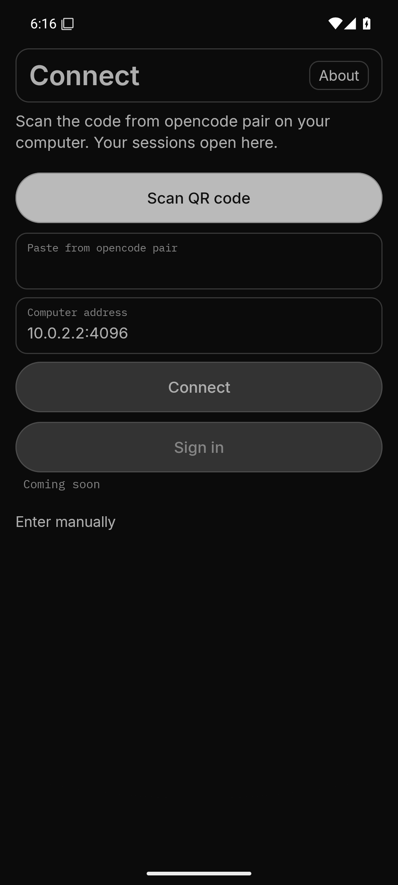
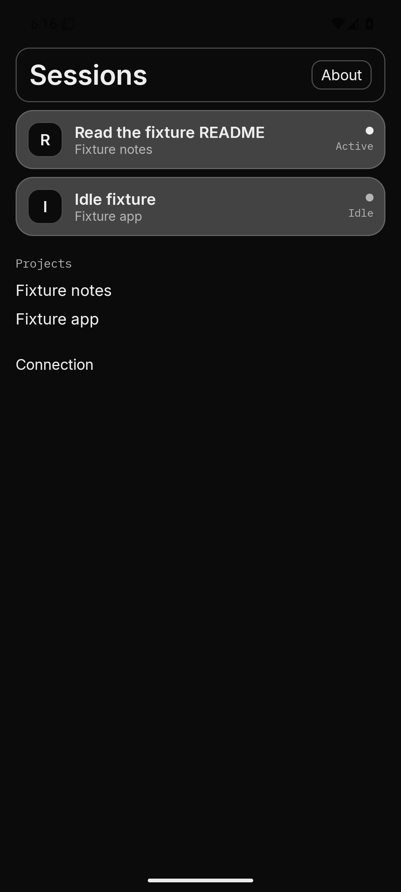
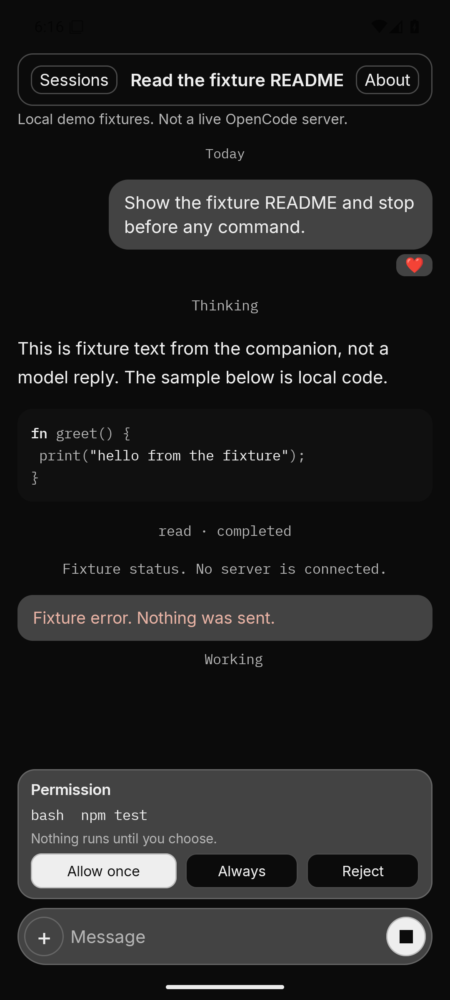
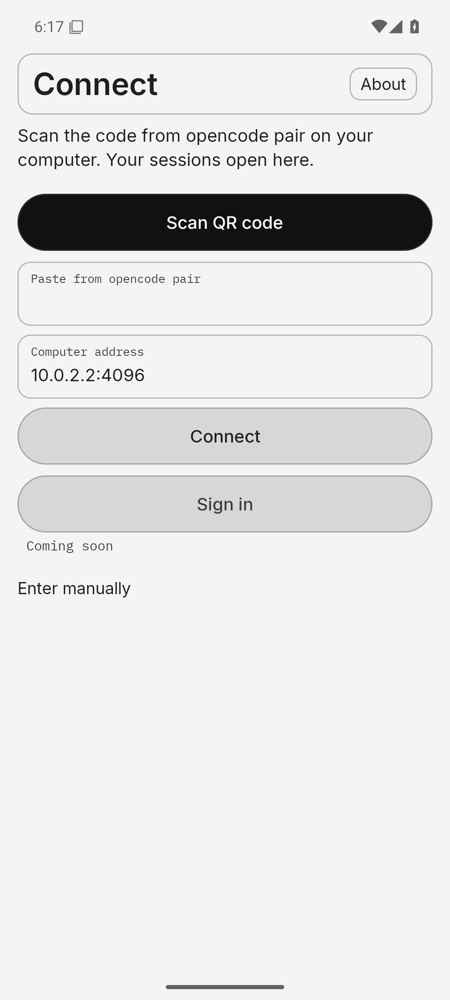
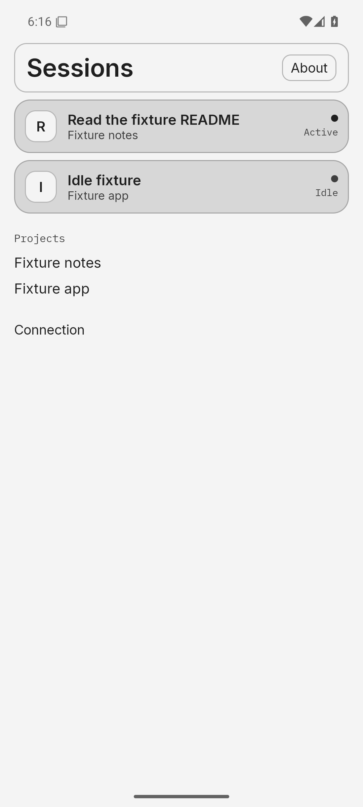
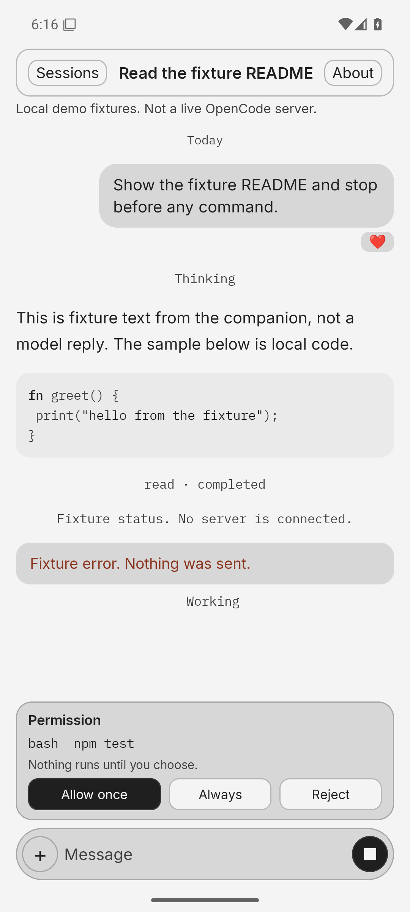

# Companion

Unofficial prototype for [OpenCode](https://opencode.ai).

Originally built by Amniscient

This is not the OpenCode app. Anomaly has not released or endorsed it. OpenCode's Android app is still described as coming soon on [opencode.ai/mobile](https://opencode.ai/mobile). The interface here is original and does not use OpenCode logo files.

The session model, demo fixtures, permission decisions, and the documented HTTP contract live in Helium (`helium/app.amni`). The Android shell draws that model in a terminal theme (system, light, or dark; ink, phosphor, amber, or cyan), speaks HTTPS with the platform trust store, and keeps the server password in the Android Keystore. Message reactions are local marks in the style of grok-remote's chat UI. OpenCode has no reaction API, so they are not synced. Demo mode does not send them.

## What it talks to

A server you run. Documented routes only:

- `GET /api/info`
- `GET /api/project`
- `GET /api/session`
- `GET /api/session/{id}/message`
- `POST /api/session/{id}/prompt`
- `POST /api/session/{id}/interrupt?resume=false`
- `POST /api/session/{id}/permission/{id}/reply` with `once`, `always`, or `reject`
- `GET /api/event` (live SSE, no replay)

HTTP Basic auth, username `opencode`, as described in the [OpenCode web docs](https://opencode.ai/docs/cli/web). HTTPS is the default. HTTP is refused unless local development is on and the host is a private address. There is no certificate bypass.

Demo fixtures are labeled in the app. They do not call a server or a model. Tool and shell actions wait for an explicit tap and are not started by the app.

To pair from a computer, run `tools/pair.py` or `opencode pair`. The phone scans the QR, including the light-on-dark code the terminal draws, stores the credential in the Android Keystore, and opens Sessions. The same link can be pasted if the camera cannot read it. See `docs/PAIRING.md`.

## Layout

| Path | Role |
|---|---|
| `helium/app.amni` | Helium core: model, contract, fixtures, view |
| `helium/main.amni` | Native test driver |
| `helium/android_main.amni` | Empty entry so the compiler keeps the exported handler |
| `android/` | Kotlin shell: TLS, Keystore, insets, touch layout |
| `tools/mock_server.py` | Local mock of the documented slice |
| `docs/design/message-delineation.md` | Layout notes for the 0.5.0 transcript |
| `docs/UPSTREAM.md` | What would be a reviewable upstream step |
| `docs/PR-DRAFT.md` | Draft text only. Nothing has been posted |

Gold was not used to generate the Helium. Its `gold build` command calls a paid model (`claude -p`), which this prototype does not do. Helium's own Android packager (`tools/mobile/android.sh`) is an SDL game shell and is not the UI here. The JNI shell exists because Helium has no TLS stack and its immediate-mode UI is not an Android accessibility tree. See `docs/HANDOFF.md`.

## Build the tests

Needs `cc` and Python 3. The script clones Helium `38a5e04940d85e27e26cf55cc3c7c4d90800cb0c` and compiles the checked-in seed compiler (`hc` 0.7). It does not run the full three-stage bootstrap.

```bash
tools/run-tests.sh
```

## Debug APK

Needs the Android SDK (platform 35, build-tools 35.0.0, NDK 27.2.12479018) and a JDK. Debug signing uses the local Gradle debug keystore. No release key is created.

```bash
export ANDROID_HOME="$HOME/Android/Sdk"
tools/build-apk.sh
```

The debug package allows cleartext at the platform layer so a private-host HTTP server can be reached. The app still refuses public HTTP. The release network config does not allow cleartext. This build does not assemble a release APK.

`tools/build-apk.sh` prints the APK path, SHA-256, `versionName`, and `minSdk`.


## Screenshots

0.6.4 (fixture demo; Connect, Sessions, open session — dark and light):

| Connect | Sessions | Session |
|---|---|---|
|  |  |  |
|  |  |  |

## Credit

Originally built by Amniscient

This app is MIT, copyright 2026 Amniscient. See LICENSE. OpenCode upstream remains Copyright (c) 2025 opencode, MIT. The Helium compiler, cloned at build time, stays Apache-2.0. The fonts stay SIL OFL 1.1. See `REBRANDING.md` for the name, package id, icon, and colors.
